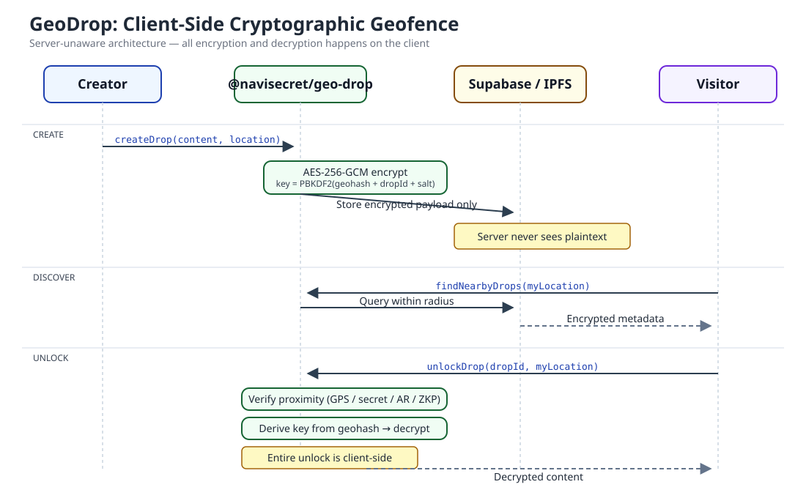
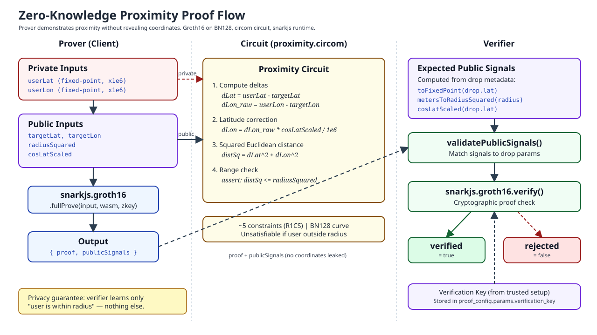
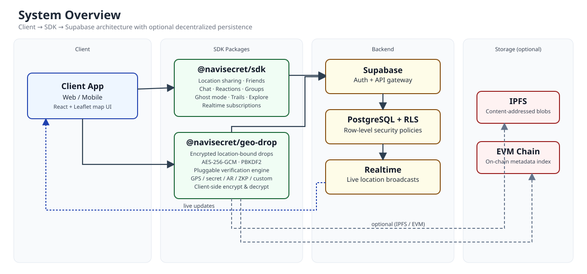

<p align="center">
  <picture>
    <source media="(prefers-color-scheme: dark)" srcset="assets/logo-dark.svg" />
    <source media="(prefers-color-scheme: light)" srcset="assets/logo-light.svg" />
    
  </picture>
</p>

<p align="center">
  <strong>Her mekan bir sır saklar.</strong><br />
  <em>Gizlilik öncelikli mekânsal sosyal ağ, şifreli konum kapsülleri, gerçek zamanlı yakınlık keşfi ve sıfır bilgi konum ispatları.</em>
</p>

<p align="center">
  <a href="README.md">
    
  </a>
</p>

<p align="center">
  <a href="LICENSE"></a>
  
  
  
  
  
  
  
  
  
  
</p>

---

## Projenin Vizyonu: "Her Mekan Bir Sır Saklar"

Sürekli gözetim altında tutulduğumuz dijital dünyada kişisel gizlilik, kolaylık uğruna feda edildi. Ticari harita ve konum servisleri; kullanıcıların hassas GPS hareketlerini merkezi sunucularda depolamakta, reklam veri simsarlarına aktarmakta ve insan adımlarını birer gelir kalemine dönüştürmektedir.

**NaviSecret, fiziksel mekânın büyüsünü ve bireysel gizlilik egemenliğini geri getiriyor.**

Sıradan bir park bankının yanından, tarihi bir sokak çeşmesinden veya ıssız bir tepeden geçtiğinizi düşünün... Tam o koordinatta asılı duran, görünmez ve şifreli bir dijital kapsül var: Yıllar önce oraya bırakılmış duygusal bir mektup, bir gezginin fotoğrafı, gizli bir hazine avının ipucu veya geleceğe bırakılmış bir ses kaydı. Bu kapsülü binlerce kilometre uzaktaki bir koltuktan açamazsınız. Sunucunun kendisi dahi içeriği göremez. **Sırrı çözebilmek için bizzat o noktada, fiziksel olarak bulunmanız gerekir.**

NaviSecret, fiziksel dünyayı insan anılarının, tesadüfi karşılaşmaların ve güvenli dijital izlerin şifreli bir tuvaline dönüştürür:
- **Gerçek Dünyaya Anı ve Sır Bırakma**: Metin, fotoğraf veya notları koordinatlara kilitleyin. Yalnızca hedef alana (örneğin 20 metre yakınına) fiziksel olarak giren kişiler içeriğe erişebilir.
- **Fiziksel Yakınlık Karşılaşmaları (NaviBump)**: Arkadaşlarınızla fiziksel dünyada yollarınız kesiştiğinde anında bildirim alın ve tek dokunuşla güvenli eşleşme başlatın.
- **Sıfır Bilgi Matematiksel Gizliliği (NaviZKP)**: Bir etkinliğe, kontrol noktasına veya mekana yakın olduğunuzu; kesin GPS koordinatlarınızı $(\text{enlem}, \text{boylam})$ sunucuya dahi vermeden kriptografik olarak kanıtlayın.
- **Tam Bağımsız ve Kendi Sunucunda (Self-Hosted)**: Üçüncü taraf harici bulut servislerine bağımlılık yok. Kendi donanımınızda sadece ~100 MB RAM tüketen bağımsız bir mikroservis kümesi olarak çalışır.

---

## NaviSecret ile Neler Yapabilirsiniz?

### 1. Konuma Kilitli Gizli Kapsüller Bırakın (NaviDrop)
- **Zaman ve Anı Kapsülleri**: Eşinizle ilk karşılaştığınız kafeye özel bir not bırakın; bu not sadece yıldönümünüzde ve sadece o kafeye tekrar gidildiğinde açılsın.
- **Şehir İçi Hazine Avları (Scavenger Hunt)**: Her ipucunun bir sonraki fiziksel durağın koordinatlarını açtığı interaktif macera rotaları oluşturun.
- **Dijital Gizli Bırakmalar (Dead-Drop)**: Hassas dosyaları veya notları uzaktan erişime kapalı olarak, sadece belirli bir sokak köşesinde fiziksel olarak duran kişilerin açabileceği şekilde paylaşın.
- **Kriptografik Mekânsal Kilit**: İçerik istemci tarayıcısında `AES-256-GCM` ile şifrelenir. Anahtar, hedef coğrafi sınıra (geofence) fiziksel olarak yaklaşıldığında PBKDF2 algoritmasıyla türetilir. Sunucu yalnızca şifreli blok görür; açık metin içeriğe asla vakıf olamaz.

<p align="center">
  
</p>

### 2. NaviBump ve Radar ile Yakındaki Kişileri Keşfedin
- **Mekânsal Radar**: Çevrenizdeki arkadaşların ve keşfedilen kapsüllerin yönünü ve mesafesini anlık olarak gösteren interaktif pusula radarı.
- **NaviBump Fiziksel Eşleşme**: NaviSecret kullanan iki arkadaş sokakta birbirine yaklaştığında sistem bunu algılar; tek dokunuşla hızlı temas kurulmasını ve güvenli sohbet başlatılmasını sağlar.
- **Yakındaki Kişilerle Güvenli İletişim**: Ev adresinizi veya tam rotanızı ifşa etmeden yakın çevrenizdeki tanıdıklarla anlık iletişimde kalın.

### 3. Sıfır Bilgi İspatları ile Matematiksel Anonimlik (NaviZKP)
- Circom diliyle geliştirilmiş ve Groth16 protokolüyle doğrulanan zk-SNARK devrelerini temel alır.
- Kullanıcının şu iddiayı kesin matematiksel doğrulukla ispatlamasını sağlar:
  $$\text{"Şu anda } (x_0, y_0) \text{ merkezli mekana en fazla } R \text{ metre mesafedeyim."}$$
- Doğrulama işlemi, kullanıcının gerçek koordinatlarını $(x_1, y_1)$ sunucuya veya üçüncü kişilere **sıfır sızıntı** ile gizli tutarak tamamlar.

<p align="center">
  
</p>

### 4. Gelişmiş Gizlilik Kalkanı ve Hayalet Modu (Ghost Mode)
- **Hassas Mod**: Seçtiğiniz en yakın arkadaşlarınıza kesin GPS konumunuzu gösterir.
- **Bulanık Mod (Fuzzy)**: Koordinatları iletmeden önce istemci üzerinde **Yerel Diferansiyel Gizlilik (Planar Laplace Gürültüsü)** uygular; mahallenizi belli eder fakat sokak ve kapı numaranızı matematiksel olarak gizler.
- **Hayalet Modu**: Kullanıcıyı haritadan anında silen acil görünmezlik modu. İsteğe bağlı olarak 30 dakika, 2 saat, 8 saat veya süresiz geri sayım sayacı tanımlanabilir.

### 5. Dahili Canlı Sohbet ve Harita Tepkileri
- Arkadaşlarla birebir uçtan uca şifreli mesajlaşma ve özel grup sohbetleri.
- Harita üzerinde arkadaşların profillerine doğrudan gönderilebilen anlık emoji pings ve dürtmeler.

### 6. Ayak İzleri ve Keşif Haritası (Sis Perdesi)
- Oyunlaştırılmış kişisel keşif: Harita başlangıçta sis perdesi (fog-of-war) ile kaplıdır; dünyayı gezdikçe keşfettiğiniz mahalleler ve sokaklar aydınlanır.
- Sunucuda kalıcı rota geçmişi tutulmaksızın, tamamen cihazınızda saklanan özel seyahat izleri.

### 7. Yerleşik Çok Dilli Altyapı (i18n)
- Harici devasa paketlere ihtiyaç duymayan hafif ve tam tip güvenli yerelleştirme motoru.
- Sayfa yenilemeden **Türkçe (`tr`)**, **İngilizce (`en`)** ve **Rusça (`ru`)** dilleri arasında anında geçiş.

---

## Sistem Mimarisi

NaviSecret; yüksek verim, kriptografik bütünlük ve asgari donanım tüketimi amacıyla tasarlanmış olay güdümlü bir mikroservis yapısına sahiptir:

<p align="center">
  
</p>

```
┌─────────────────────────────────────────────────────────────────────────────┐
│                           İstemci Web Uygulaması                            │
│       (React 19, TypeScript, Tailwind CSS 4, Leaflet, Web Crypto API)       │
└──────────────────────────────────────┬──────────────────────────────────────┘
                                       │ HTTP / WebSocket (Ters Vekil :3000)
                                       ▼
┌─────────────────────────────────────────────────────────────────────────────┐
│                         Nginx Web Sunucu Konteyneri                         │
│         - Üretim Tek Sayfa Uygulaması (SPA) Sunumu                          │
│         - /api/* ve /ws (WebSocket) İstekleri İçin Ters Vekil (Proxy)       │
│         - Katı Güvenlik Başlıkları (CSP, HSTS, X-Frame-Options)             │
│         - Çift Yığın IPv4 ve IPv6 Ağ Desteği                                │
└──────────────────────────────────────┬──────────────────────────────────────┘
                                       │ Dahili Köprü Ağı (Bridge)
                                       ▼
┌─────────────────────────────────────────────────────────────────────────────┐
│                     NaviSecret API Çekirdeği (:8000)                        │
│         - Node.js 22 LTS + Fastify 5.x Asenkron Web İskeleti                │
│         - Yüksek Kapasiteli Gerçek Zamanlı WebSocket Sunucusu (/ws)         │
│         - JWT Kimlik Doğrulama ve Bcrypt Parola Güvenliği                   │
│         - Hibrit Veritabanı Motoru (PostgreSQL 16 + Gömülü SQLite)          │
└───────────────────────┬─────────────────────────────┬───────────────────────┘
                        │                             │
                        ▼                             ▼
┌────────────────────────────────┐           ┌────────────────────────────────┐
│      PostgreSQL 16 (:5433)     │           │         Redis 7 (:6379)        │
│  - Mekânsal Geometri İndeksleri│           │  - Bellek İçi Mekânsal Önbellek│
│  - İlişkisel Veri Bütünlüğü    │           │  - Yüksek Kapasiteli Pub/Sub   │
│  - Kullanıcılar, Kapsüller     │           │  - Anlık Çevrimiçi Durumları   │
└────────────────────────────────┘           └────────────────────────────────┘
```

---

## Teknik Özellikler

| Katman | Bileşen | Teknoloji | Seçim Gerekçesi |
| :--- | :--- | :--- | :--- |
| **Önyüz** | Tek Sayfa Uygulaması (SPA) | React 19, TypeScript 5.6, Vite 6 | Eşzamanlı render, tip güvenliği, milisaniyeler içinde hot reload |
| **Arayüz Tasarımı** | Stil ve İkonografi | Tailwind CSS 4, Lucide React | Modern CSS altyapısı, fütüristik/siberpunk görsel kimlik |
| **Kartografya** | Harita ve Katmanlar | Leaflet 1.9, React-Leaflet | Bağımsız, telif ücreti olmayan harita (OpenStreetMap + Esri uydu) |
| **API Sunucusu** | Yüksek Verimli Ağ Geçidi | Node.js 22 LTS, Fastify 5.x | Minimum sistem yükü, hızlı JSON serileştirme, yerel WebSocket |
| **Veritabanı** | İlişkisel ve Mekânsal Motor | PostgreSQL 16 Alpine | ACID uyumluluğu, mekânsal indeksler, otomatik SQLite yedek motoru |
| **Önbellek & Mesaj**| Anlık Konum Dağıtımı | Redis 7 Alpine | Mikrosaniye düzeyinde konum dağıtımı ve Pub/Sub kuyruk yönetimi |
| **Sıfır Bilgi (ZKP)**| Yakınlık Doğrulama | Circom, snarkjs, Groth16 | Koordinatları sızdırmadan fiziksel yakınlığı ispatlayan matematiksel kanıt |
| **Şifreleme** | İstemci Tarafı Kriptografi | Web Crypto API, AES-256-GCM, PBKDF2 | Tarayıcıda yerel donanım hızlandırmalı şifreleme ve anahtar türetimi |
| **Dağıtım** | Konteynerleştirme | Docker, Docker Compose, Nginx Alpine | Toplamda yalnızca ~100 MB RAM tüketen izole 4 konteynerlik mimari |

---

## Kriptografik ve Matematiksel Modeller

### 1. Geo-Kapsüller İçin Mekânsal Anahtar Türetimi
Bir kullanıcı $(\text{enlem}, \text{boylam})$ koordinatına bir kapsül kilitlediğinde, şifre çözme anahtarı sunucuya gönderilmez. Anahtar doğrudan istemcide türetilir:

$$K = \text{PBKDF2}\Big(\text{PRF}=\text{HMAC-SHA256},\ S=\text{Geohash}_8(\text{lat}, \text{lon}) \parallel \text{Salt}_{\text{kapsul}},\ c=100\,000,\ \text{len}=256\Big)$$

Veri gövdesi `AES-256-GCM` ile şifrelenir:

$$C, T = \text{AES-GCM-Encrypt}(K, IV, P)$$

Sunucuda yalnızca şifreli metin $C$ ve doğrulama etiketi $T$ saklanır. $P$ içeriğini açmak isteyen kişi ancak fiziksel olarak o koordinata giderek doğru anahtarı türetebilir.

### 2. Sıfır Bilgi Yakınlık İspatları (zk-SNARKs)
Circom devresi ve Groth16 protokolü kullanılarak, ispatçı gizli $(x_1, y_1)$ koordinatlarının halka açık $(x_0, y_0)$ mekanına olan mesafesini ispatlar:

$$(x_1 - x_0)^2 + (y_1 - y_0)^2 \le R^2$$

Üretilen $\pi = (A \in \mathbb{G}_1, B \in \mathbb{G}_2, C \in \mathbb{G}_1)$ kanıtı, kullanıcının gerçek koordinatlarını hiçbir şekilde açık etmeden 5 milisaniyenin altında doğrulanır.

### 3. Düzlemsel Laplace Diferansiyel Gizlilik Modeli
Bulanık mod aktifken koordinatlar istemciden çıkmadan önce kutupsal $(r, \theta)$ düzleminde öteleme gürültüsüne tabi tutulur:

$$f(r, \theta) = \frac{\epsilon^2}{2\pi} e^{-\epsilon r}$$

Burada $\epsilon$ gizlilik bütçesini ifade eder; bina ve sokak seviyesindeki hassas konumları semt ve bölge geneline güvenle yayar.

---

## Proje Dizin Yapısı

```
NaviSecret/
├── apps/
│   ├── web/                          # Üretim Önyüz Uygulaması (React 19 + Vite)
│   │   ├── src/
│   │   │   ├── components/           # Modallar, Harita, Radar, Sohbet, Alt Panel
│   │   │   │   ├── auth/             # Kayıt ve Giriş Formları
│   │   │   │   ├── bumps/            # NaviBump Yakınlık Algılama Paneli
│   │   │   │   ├── capsules/         # Gizli Kapsül Bırakma ve Kilit Açma Modalları
│   │   │   │   ├── chat/             # Birebir ve Grup Sohbet Bileşenleri
│   │   │   │   ├── map/              # Leaflet Harita, Radar, Patika ve Keşif Katmanları
│   │   │   │   └── common/           # Çok Dilli Dil Seçici ve Fütüristik İkonlar
│   │   │   ├── hooks/                # Özel React Kancaları (useAuth, useLocation, useLanguage)
│   │   │   ├── i18n/                 # Yerelleştirme Motoru (en, tr, ru sözlükleri ve store)
│   │   │   └── types/                # Veri Tipleri ve Modelleri
│   │   └── vite.config.ts            # Vite Yapılandırması
│   │
│   └── server/                       # Üretim API Sunucusu (Fastify + Node.js 22)
│       ├── src/
│       │   ├── database/             # PostgreSQL / SQLite Hibrit Bağlantı ve Şemalar
│       │   ├── modules/              # Modüler Rotalar (auth, capsules, chat, presence, social)
│       │   ├── realtime/             # Yerel WebSocket Sunucusu ve Olay Dağıtıcı
│       │   ├── redis/                # Redis Pub/Sub ve Mekânsal Önbellek İstemcisi
│       │   └── index.ts              # Fastify Sunucu Başlangıç Dosyası
│       └── Dockerfile                # Üretim Sunucu Docker Dosyası
│
├── packages/
│   ├── sdk/                          # @navisecret/sdk — Konum Paylaşım İstemci Çekirdeği
│   └── geo-drop/                     # @navisecret/geo-drop — Kriptografik Drop Motoru
│       └── circuits/                 # Circom zk-SNARK Yakınlık Devreleri
│
├── docker/
│   ├── nginx/
│   │   └── default.conf              # Nginx Ters Vekil ve Güvenlik Ayarları
│   └── init-db/
│       └── 01-schema.sql             # PostgreSQL Veritabanı Başlangıç Betiği
│
├── assets/                           # Vektörel Şemalar, Akış Grafikleri ve Logolar
├── compose.yaml                      # 4 Servisli Docker Compose Üretim Yığını
├── Dockerfile                        # Nginx Web Önyüz Docker Dosyası
└── package.json                      # Monorepo Çalışma Alanı Yapılandırması
```

---

## Hızlı Başlangıç ve Dağıtım

### Docker Compose ile Tek Adımda Üretim Kurulumu (Önerilen)

NaviSecret, harici veritabanı veya BaaS hesabı gerektirmeyen bağımsız 4 konteynerlik bir küme olarak çalışır:

1. **Depoyu klonlayın:**
   ```bash
   git clone https://github.com/ersinsandal/NaviSecret.git
   cd NaviSecret
   ```

2. **Ortam değişkenlerini hazırlayın:**
   ```bash
   cp .env.example .env
   ```
   *`.env` dosyası içerisinden `JWT_SECRET` ve veritabanı parolalarını belirleyebilirsiniz.*

3. **Konteyner yığınını başlatın:**
   ```bash
   docker compose up -d --build
   ```

4. **Konteyner sağlık durumlarını kontrol edin:**
   ```bash
   docker compose ps
   ```

   Dört servis de **Up (healthy)** durumuna gelecektir:
   ```
   NAME                  IMAGE                   STATUS                    PORTS
   navisecret_api        navisecret-api:latest   Up (healthy)              0.0.0.0:8000->8000/tcp
   navisecret_postgres   postgres:16-alpine      Up (healthy)              0.0.0.0:5433->5432/tcp
   navisecret_redis      redis:7-alpine          Up (healthy)              0.0.0.0:6379->6379/tcp
   navisecret_web        navisecret-web:latest   Up (healthy)              0.0.0.0:3000->80/tcp
   ```

5. **Uygulamayı kullanmaya başlayın:**
   - Web Arayüzü: `http://localhost:3000`
   - API Sağlık Kontrolü: `http://localhost:8000/health`
   - Canlı WebSocket Sunucusu: `ws://localhost:8000/ws`

---

## Yerel Geliştirme Ortamı

Kod üzerinde doğrudan geliştirmeler yapmak için:

### Gereksinimler

- **Node.js**: `22.x LTS`
- **pnpm**: `10.x` veya üzeri

### Adımlar

1. **Bağımlılıkları yükleyin:**
   ```bash
   pnpm install
   ```

2. **Dahili paketleri derleyin:**
   ```bash
   pnpm build
   ```

3. **Fastify API Sunucusunu çalıştırın:**
   ```bash
   pnpm dev:server
   ```
   *Sunucu `http://localhost:8000` adresinde hot reload ile açılır.*

4. **Vite Web Arayüzünü çalıştırın:**
   ```bash
   pnpm dev:web
   ```
   *Önyüz `http://localhost:5173` adresinde başlatılır.*

5. **Testleri çalıştırın:**
   ```bash
   pnpm test
   ```

---

## REST ve WebSocket API Referansı

Korumalı tüm rotalar `Authorization: Bearer <token>` başlığı gerektirir.

### Kimlik Doğrulama ve Profil (`/api/auth`)
| Yöntem | Uç Nokta | Açıklama |
| :--- | :--- | :--- |
| `POST` | `/api/auth/register` | Kullanıcı adı ve parola ile yeni hesap oluşturur |
| `POST` | `/api/auth/login` | Kimlik doğrular ve JWT erişim belirteci üretir |
| `GET` | `/api/auth/me` | Giriş yapmış kullanıcının profil detaylarını getirir |
| `POST` | `/api/auth/avatar` | Kullanıcı profil resmini günceller |

### Konum ve Görünürlük (`/api/presence`)
| Yöntem | Uç Nokta | Açıklama |
| :--- | :--- | :--- |
| `POST` | `/api/presence/pulse` | Anlık konum sinyali gönderir (enlem, boylam, doğruluk) |
| `GET` | `/api/presence/friends` | Görünür durumdaki arkadaşların anlık konumlarını döner |
| `POST` | `/api/presence/ghost` | Hayalet Modunu açar veya kapatır (süre kısıtlı olabilir) |

### Gizli Kapsüller (`/api/capsules`)
| Yöntem | Uç Nokta | Açıklama |
| :--- | :--- | :--- |
| `POST` | `/api/capsules` | Koordinata bağlı şifreli kapsül oluşturur |
| `GET` | `/api/capsules/nearby` | Kullanıcının yakın çevresindeki kapsülleri getirir |
| `POST` | `/api/capsules/:id/unlock` | Yakınlık ispatını sunarak kapsül içeriğini açar |

### Sosyal ve Arkadaşlık (`/api/social`)
| Yöntem | Uç Nokta | Açıklama |
| :--- | :--- | :--- |
| `GET` | `/api/social/friends` | Çevrimiçi durumlarıyla birlikte arkadaşları listeler |
| `POST` | `/api/social/request` | Kullanıcı adına veya etiketine arkadaşlık isteği gönderir |
| `POST` | `/api/social/accept` | Gelen arkadaşlık davetini onaylar |
| `POST` | `/api/social/block` | Bir kullanıcının konum erişimini engeller |

### Canlı WebSocket Protokolü (`ws://localhost:8000/ws`)

```json
// İstemci -> Sunucu: Konum güncelleme sinyali
{
  "type": "LOCATION_PULSE",
  "data": {
    "latitude": 41.0082,
    "longitude": 28.9784,
    "accuracy": 8.5
  }
}

// Sunucu -> İstemci: Arkadaşın konumu güncellendi
{
  "event": "FRIEND_LOCATION",
  "data": {
    "userId": "usr_7a8b9c",
    "username": "alex",
    "latitude": 41.0089,
    "longitude": 28.9790,
    "updatedAt": 1792261500000
  }
}
```

---

## Güvenlik ve Gizlilik Standartları

- **Şirket Gözetimi Yok**: Reklam pikselleri, telemetri takipçileri veya üçüncü taraf analiz kütüphaneleri bulunmaz.
- **İstemci Tarafı İzolasyon**: Kapsül içerikleri cihazınızdan çıkmadan şifrelenir; veritabanı yöneticisi veya ağ dinleyicileri sırları açık metin olarak göremez.
- **Bcrypt Parola Güvenliği**: Parolalar yüksek tuzlama döngüleriyle tek yönlü şifrelenir.
- **Güçlendirilmiş Konteyner Mimarisi**: İzole Docker köprü ağı, katı CSP başlıkları ve yetkisiz konteyner kullanıcıları.

---

## Lisans ve Telif Hakkı

NaviSecret açık kaynaklıdır ve **MIT Lisansı** ile lisanslanmıştır — ayrıntılar için [LICENSE](LICENSE) dosyasına bakabilirsiniz.

```
Telif Hakkı (c) 2026 Ersin Sandal (SliferSoft)
```
